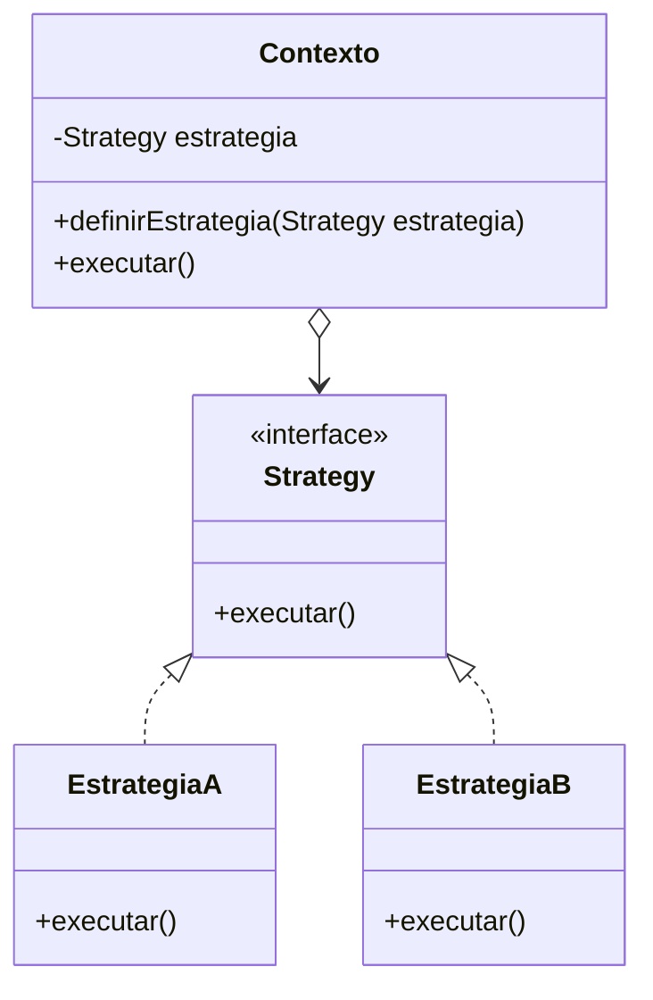

# Estrutura-base do Strategy

Este diretório reúne a base teórica do padrão **Strategy**.

O objetivo aqui não é apenas mostrar um exemplo simples, mas demonstrar a
estrutura conceitual e os cenários em que o padrão faz sentido.

## 1) Ideia central

O padrão Strategy resolve um problema muito comum:

> "Uma classe precisa executar diferentes comportamentos, mas não deve ficar
> presa a vários `if`/`else` ou `switch` para decidir qual algoritmo usar."

Em vez disso, o padrão separa:

- o comportamento principal (o Contexto);
- a interface do algoritmo (Strategy);
- as implementações concretas (Concrete Strategies).

Assim, o objeto principal não precisa saber todos os detalhes da lógica. Ele
apenas conhece uma interface comum e delega a execução para a estratégia que
foi escolhida.

## 2) Estrutura do padrão

A estrutura geral é:

- `Context`: é a classe que usa a estratégia.
- `Strategy`: define o contrato do algoritmo.
- `ConcreteStrategyA`, `ConcreteStrategyB`, ...: implementações do contrato.

Em termos práticos, o `Context` guarda uma referência a uma `Strategy` e
exige que a estratégia seja trocada em tempo de execução, sem alterar a classe
principal.

## 3) Como a ideia funciona na prática

Imagine um editor de texto:

- o editor precisa formatar o texto;
- pode formatar em maiúsculas;
- pode formatar em minúsculas;
- pode adicionar prefixo;
- pode aplicar outra regra no futuro.

Se todas essas regras fossem colocadas dentro do editor usando `if`, o código
cresceria muito. Além disso, cada alteração exigiria mexer na mesma classe.

Com o padrão Strategy, a lógica deixa de ser "decidida no meio do método" e
passa a ser "troca de comportamento por composição".

## 4) Quando usar Strategy

Use Strategy quando:

- há vários algoritmos possíveis para a mesma tarefa;
- o comportamento precisa mudar em tempo de execução;
- o código tem muitos `if`, `else if` ou `switch`;
- você quer evitar acoplamento entre a classe principal e regras específicas;
- você deseja facilitar a manutenção, extensão e testes;
- regras diferentes podem ser reutilizadas em outro contexto.

## 5) Quando não usar Strategy

O padrão não é obrigatório sempre. Evite-o quando:

- há apenas uma forma de executar a operação;
- as mudanças são pequenas e raras;
- usar Strategy complicaria mais do que simplificaria;
- a lógica muda apenas por estado interno simples e não por diferentes
  algoritmos;
- a situação não exige extensão futura.

## 6) Formas que podem acontecer no mundo real

### Caso 1: Rota de navegação

Um aplicativo de mapa pode calcular a melhor rota por:

- carro;
- transporte público;
- a pé;
- bicicleta.

A classe `Navegador` não precisa saber a lógica interna de cada rota. Ela só
conhece a interface `EstratégiaDeRota` e executa o algoritmo escolhido.

### Caso 2: Pagamento de pedidos

Um sistema de e-commerce pode aceitar:

- cartão de crédito;
- PayPal;
- boleto;
- pix.

Cada forma de pagamento tem regras diferentes. O `Pedido` apenas delega o
pagamento para a estratégia ativa.

### Caso 3: Exportação de relatórios

Uma aplicação pode exportar relatórios em:

- PDF;
- CSV;
- Excel.

Cada formato exige regras diferentes para montagem e organização dos dados.

### Caso 4: Descontos promocionais

Um carrinho de compras pode aplicar:

- sem desconto;
- 10% de desconto;
- 20% de desconto;
- cupom especial;
- desconto VIP.

Aqui, a classe principal continua simples e cada regra fica isolada.

### Caso 5: Autenticação de usuários

Um sistema pode autenticar por:

- e-mail e senha;
- login via Google;
- login via GitHub;
- login por biometria.

Cada estratégia usa dados diferentes e verifica o usuário com sua própria
lógica.

## 7) Vantagens do padrão

- facilita a extensão;
- elimina lógica espalhada em `if`s;
- permite trocar comportamentos em tempo de execução;
- reduz acoplamento;
- melhora a organização do código;
- cada estratégia pode ser testada separadamente.

## 8) Desvantagens

- aumenta o número de classes;
- pode ser exagerado quando há pouca variação;
- exige mais planejamento para manter as abstrações claras.

## 9) Estrutura básica em Java

A implementação abaixo mostra a estrutura mínima do padrão Strategy com
comentários detalhados.

### Diagrama conceitual

A lógica principal está no `Contexto`, mas a implementação real fica em cada
`ConcreteStrategy`.

## 10) Conclusão

O Strategy é um padrão excelente quando o comportamento pode variar e a classe
principal precisa manter uma interface simples.

Em vez de acoplar regras diferentes ao mesmo objeto, o padrão separa o que muda
(do que permanece constante). Isso deixa o sistema mais flexível, mais fácil de
estender e mais organizado.
