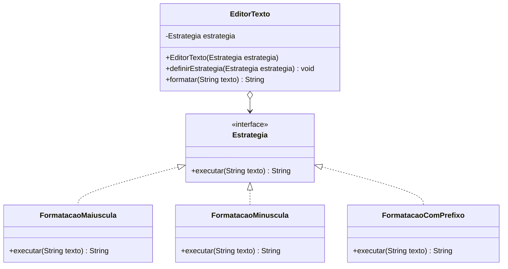

# Diagrama conceitual do Strategy

O `EditorTexto` é o Contexto.
O `Estrategia` representa a interface comum.
As classes `FormatacaoMaiuscula`, `FormatacaoMinuscula` e
`FormatacaoComPrefixo` são as Concrete Strategies.

Cada uma implementa o mesmo contrato, mas com regras diferentes.
