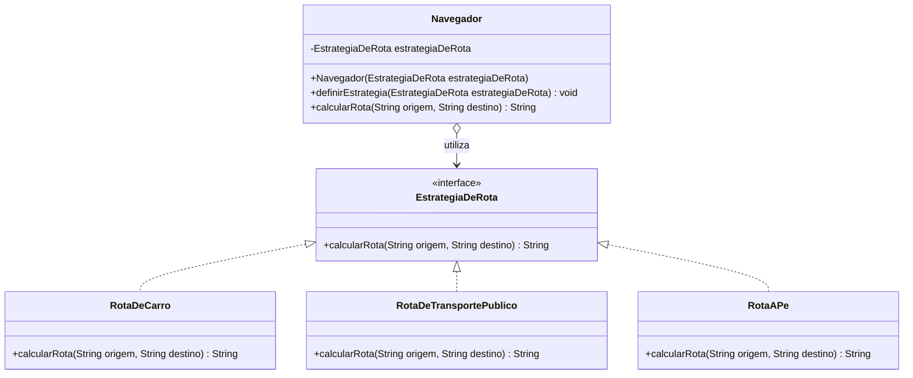

# Diagrama UML - Strategy

## Participantes do padrão

- **Navegador**: contexto que delega o cálculo para a estratégia selecionada.
- **EstrategiaDeRota**: interface comum das estratégias.
- **RotaDeCarro**, **RotaDeTransportePublico** e **RotaAPe**: estratégias concretas.

