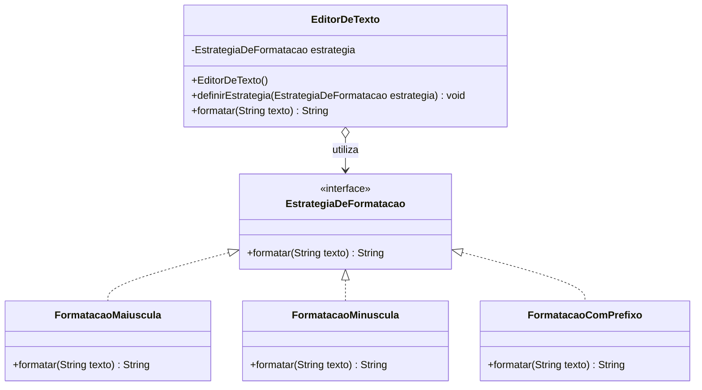

# Diagrama UML - Strategy

## Participantes do padrão

- **EditorDeTexto**: contexto que delega a formatação para a estratégia selecionada.
- **EstrategiaDeFormatacao**: interface comum das estratégias.
- **FormatacaoMaiuscula**, **FormatacaoMinuscula** e **FormatacaoComPrefixo**:
  estratégias concretas, cada uma com uma forma diferente de formatar o texto.
