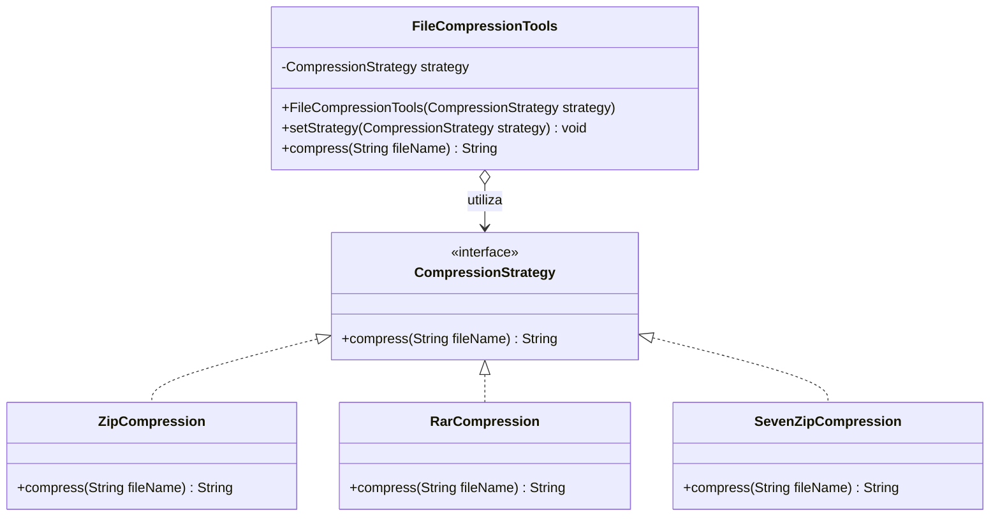

# Diagrama UML - Strategy

## Participantes do padrão

- **FileCompressionTools**: contexto que delega a compressao para a estrategia
  selecionada.
- **CompressionStrategy**: interface comum dos algoritmos.
- **ZipCompression**, **RarCompression** e **SevenZipCompression**:
  estrategias concretas.
