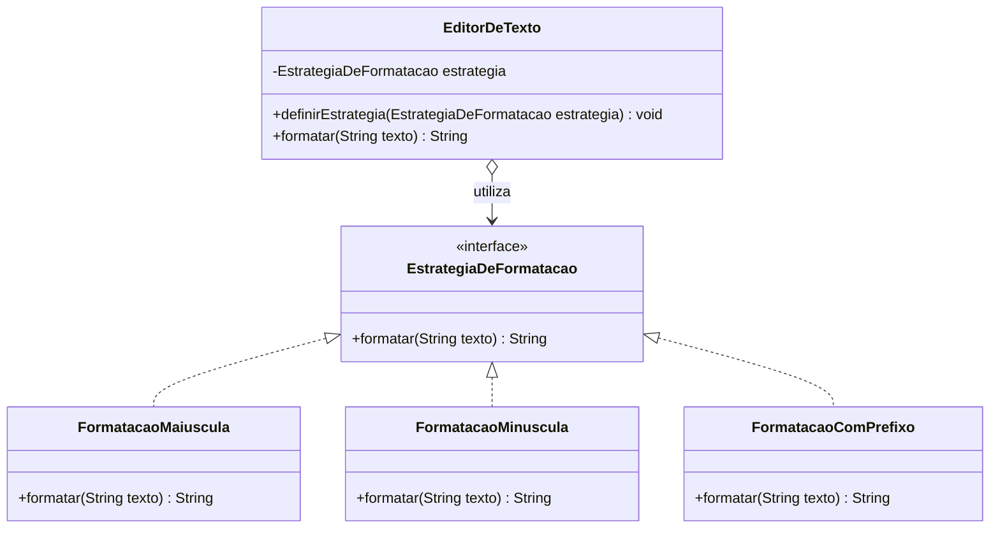

# Padrão de Projeto Strategy

## Definição

O **Strategy** (Estratégia) define uma família de algoritmos, coloca cada
algoritmo em uma classe separada e permite trocar o algoritmo utilizado sem
alterar o objeto principal.

Em outras palavras, o contexto não precisa conhecer os detalhes de cada
implementação. Ele apenas conhece uma interface comum e delega o trabalho
para a estratégia escolhida.

### Participantes

- **Context**: objeto principal que usa uma estratégia.
- **Strategy**: interface ou classe abstrata com o contrato dos algoritmos.
- **Concrete Strategies**: implementações diferentes do mesmo contrato.

## Diagrama de classe



O `EditorDeTexto` é o **Context**. A interface `EstrategiaDeFormatacao`
define o contrato, e as três classes de formatação são as **Concrete
Strategies**. A estratégia pode ser trocada durante a execução.

## Quando usar

Use Strategy quando:

- existem várias formas de realizar a mesma operação;
- o código possui muitos `if` ou `switch` para escolher um algoritmo;
- é necessário trocar o comportamento em tempo de execução;
- as regras podem crescer ou mudar independentemente do contexto;
- deseja testar cada algoritmo de forma isolada.

## Quando não usar

Evite Strategy quando:

- existe apenas um algoritmo e não há expectativa real de variações;
- as diferenças entre os comportamentos são muito pequenas;
- criar várias classes deixaria o código mais complexo do que alguns
  `if` simples;
- o comportamento muda principalmente por causa de um **estado interno** do
  objeto, e não por uma escolha de algoritmo.

O padrão não deve ser usado apenas para eliminar qualquer `if`. A abstração
precisa trazer clareza ou facilitar uma mudança provável.

---

## Exemplo sem Strategy

O contexto concentra todas as regras de formatação:

```java
public String formatar(String texto, String tipo) {
    if (tipo.equals("MAIUSCULA")) {
        return texto.toUpperCase();
    } else if (tipo.equals("MINUSCULA")) {
        return texto.toLowerCase();
    } else if (tipo.equals("PREFIXO")) {
        return "[FORMATADO] " + texto;
    }

    return texto;
}
```

Cada nova forma de formatação exige alterar esse método. Com o tempo, ele
pode ficar grande e difícil de testar.

### O que há de errado neste código

| # | Problema | Por que é ruim |
|---|---|---|
| 1 | **Fere o OCP** (Aberto/Fechado) | Para criar uma nova formatação (ex.: "título"), é preciso **editar o método**. Cada edição pode quebrar algo que já funcionava. |
| 2 | **Fere o SRP** (Responsabilidade Única) | O método **decide qual algoritmo usar** (os `if`) e também **executa todos os algoritmos**. Qualquer mudança em qualquer regra mexe no mesmo lugar. |
| 3 | **Cresce sem controle** | Com 3 formatações é tranquilo; com 15 vira um método gigante, cheio de `else if`, difícil de ler e manter. |
| 4 | **Difícil de testar** | Para testar só o prefixo, é preciso passar pelo método inteiro. Um erro em outro ramo pode atrapalhar. |
| 5 | **Frágil por usar `String`** | O parâmetro `tipo` é um texto solto. Se alguém escrever `"MAISCULA"`, o compilador não avisa: cai no `return texto` final e o bug passa em silêncio. |
| 6 | **Comportamento preso à chamada** | O `tipo` precisa ser passado toda vez. O objeto não "guarda" qual formatação está usando. |
| 7 | **Alto acoplamento** | Quem usa o método depende de códigos de texto (`"MAIUSCULA"`) e de detalhes internos de como cada formatação funciona. |

---

## Exemplo com Strategy

Primeiro, define-se um contrato comum. Ele diz **o que** toda formatação
deve fazer, sem dizer **como**:

```java
public interface EstrategiaDeFormatacao {
    String formatar(String texto);
}
```

Depois, cada algoritmo fica em sua própria classe:

```java
public class FormatacaoMaiuscula
        implements EstrategiaDeFormatacao {

    public String formatar(String texto) {
        return texto.toUpperCase();
    }
}

public class FormatacaoMinuscula
        implements EstrategiaDeFormatacao {

    public String formatar(String texto) {
        return texto.toLowerCase();
    }
}

public class FormatacaoComPrefixo
        implements EstrategiaDeFormatacao {

    public String formatar(String texto) {
        return "[FORMATADO] " + texto;
    }
}
```

O contexto delega a operação:

```java
public class EditorDeTexto {
    private EstrategiaDeFormatacao estrategia;

    public void definirEstrategia(EstrategiaDeFormatacao estrategia) {
        this.estrategia = estrategia;
    }

    public String formatar(String texto) {
        return estrategia.formatar(texto);
    }
}
```

Uso:

```java
EditorDeTexto editor = new EditorDeTexto();

editor.definirEstrategia(new FormatacaoMaiuscula());
editor.formatar("Olá"); // OLÁ

editor.definirEstrategia(new FormatacaoMinuscula());
editor.formatar("Olá"); // olá
```

O mesmo `editor` e o mesmo método `formatar` produzem resultados diferentes
só porque a estratégia mudou. O `EditorDeTexto` **não sabe** se o texto vai
ficar em maiúsculas, minúsculas ou com prefixo: ele conhece apenas a
interface e delega. Não há nenhum `if`.

### Como cada problema foi resolvido

| Problema sem Strategy | Como o Strategy resolve |
|---|---|
| Nova formatação exige editar o método (fere OCP). | Basta criar uma **nova classe** que implemente a interface. O `EditorDeTexto` não muda. |
| Uma classe concentra todas as regras (fere SRP). | Cada estratégia tem **uma única responsabilidade**. |
| `if/else` enorme. | Some. O **polimorfismo** escolhe o comportamento. |
| Teste difícil. | Cada estratégia é testada **isoladamente**. |
| `String` frágil, sem checagem do compilador. | Passa-se um **objeto tipado**; erro de digitação vira erro de compilação. |
| Comportamento preso à chamada. | A estratégia fica **guardada no contexto** e pode ser **trocada em tempo de execução**. |
| Alto acoplamento. | O contexto depende só da **interface** (abstração). |

### Exemplo de teste isolado

Como cada algoritmo é uma classe independente, o teste não depende do
contexto:

```java
@Test
void deveFormatarEmMaiusculas() {
    EstrategiaDeFormatacao estrategia = new FormatacaoMaiuscula();

    assertEquals("OLÁ", estrategia.formatar("Olá"));
}
```

---

## Strategy e os princípios SOLID

O Strategy é um dos exemplos mais claros de como os princípios SOLID
funcionam na prática. Veja cada letra aplicada ao exemplo.

### S: Single Responsibility Principle (Responsabilidade Única)

> Uma classe deve ter **um único motivo para mudar**.

- **Sem Strategy:** o método `formatar` muda se a regra de maiúscula mudar,
  se a de prefixo mudar, se entrar um novo tipo... São **vários motivos para
  mudar** na mesma classe.
- **Com Strategy:** `FormatacaoMaiuscula` só muda se a regra de maiúscula
  mudar. `EditorDeTexto` só muda se a forma de **usar** uma formatação
  mudar. Cada classe tem **um motivo**.

### O: Open/Closed Principle (Aberto/Fechado)

> Classes devem estar **abertas para extensão** e **fechadas para
> modificação**.

- **Sem Strategy:** para adicionar "título", você **modifica** o método
  existente.
- **Com Strategy:** você **estende** criando uma nova classe, sem tocar no
  `EditorDeTexto` nem nas outras estratégias:

```java
public class FormatacaoTitulo implements EstrategiaDeFormatacao {
    public String formatar(String texto) {
        return Character.toUpperCase(texto.charAt(0)) + texto.substring(1);
    }
}
```

> **Cuidado:** o OCP vale para o **contexto** e para as estratégias já
> existentes. Em algum lugar (cliente, fábrica ou configuração) ainda é
> preciso escolher qual estratégia usar. Esse ponto pode precisar mudar, mas
> o núcleo do sistema permanece intacto.

### L: Liskov Substitution Principle (Substituição de Liskov)

> Qualquer implementação deve poder **substituir** a interface sem quebrar
> o comportamento esperado.

Toda estratégia precisa respeitar o contrato. O contexto deve funcionar com
qualquer uma delas, sem precisar saber qual é. **Violação:**

```java
public class FormatacaoQuebrada implements EstrategiaDeFormatacao {
    public String formatar(String texto) {
        throw new UnsupportedOperationException(); // quebra o contrato
    }
}
```

Se o contexto precisasse fazer `if (estrategia instanceof ...)` para evitar
essa classe, a substituição não estaria funcionando. Por isso o documento
diz: *"todas as estratégias precisam respeitar o mesmo contrato"*.

### I: Interface Segregation Principle (Segregação de Interface)

> Ninguém deve ser forçado a depender de métodos que **não usa**.

A interface do Strategy é **pequena e focada**: um único método. Compare com
uma interface "gorda":

```java
// Ruim: obriga cada formatação a implementar o que não precisa
public interface EstrategiaGorda {
    String formatar(String texto);
    void salvarEmArquivo(String texto);
    void enviarPorEmail(String texto);
}
```

No Strategy, a interface tem apenas o necessário para o algoritmo.

### D: Dependency Inversion Principle (Inversão de Dependência)

> Módulos de alto nível devem depender de **abstrações**, não de
> implementações concretas.

- **Sem Strategy:** o código de alto nível depende dos detalhes concretos
  (cada ramo do `if`).
- **Com Strategy:** o `EditorDeTexto` (alto nível) depende da interface
  `EstrategiaDeFormatacao` (abstração). As classes concretas também dependem
  dessa abstração. A dependência é **invertida**.

O ideal é receber a estratégia de fora (injeção de dependência), em vez de
criá-la dentro do contexto:

```java
// Ruim: o contexto cria a implementação concreta
public class EditorDeTexto {
    private EstrategiaDeFormatacao estrategia = new FormatacaoMaiuscula();
}

// Bom: recebe a abstração de fora
public class EditorDeTexto {
    private EstrategiaDeFormatacao estrategia;

    public EditorDeTexto(EstrategiaDeFormatacao estrategia) {
        this.estrategia = estrategia;
    }
}
```

### Resumo SOLID x Strategy

| Princípio | Como o Strategy atende |
|---|---|
| **S**RP | Cada algoritmo em uma classe, com um único motivo para mudar. |
| **O**CP | Novos comportamentos entram como **novas classes**, sem alterar o contexto. |
| **L**SP | Qualquer estratégia pode ser trocada por outra sem quebrar o contexto. |
| **I**SP | Interface pequena, com só o método necessário. |
| **D**IP | O contexto depende da **interface**, não das classes concretas. |

---

## Strategy x State

Os dois padrões usam composição e podem trocar um objeto que implementa uma
interface, mas a intenção é diferente:

| Strategy | State |
|---|---|
| Escolhe uma forma de executar um algoritmo. | Representa o estado atual de um objeto. |
| A troca normalmente é uma decisão do cliente ou da configuração. | A troca normalmente acontece por transições e regras do próprio objeto. |
| As estratégias costumam ser alternativas independentes. | Os estados podem conhecer ou provocar mudanças para outros estados. |
| Exemplo: formatar texto em maiúsculas ou minúsculas. | Exemplo: pedido pendente, pago ou cancelado. |

Uma pergunta útil é: **estou escolhendo como fazer algo ou o objeto está
mudando de situação?** A primeira opção indica Strategy; a segunda indica
State.

---

## Pegadinhas e cuidados

- O contexto deve depender da interface, e não das classes concretas.
- Todas as estratégias precisam respeitar o mesmo contrato.
- Evite colocar regras de seleção dentro das estratégias; essa decisão deve
  ficar no cliente, em uma fábrica ou em uma configuração apropriada.
- **A decisão de qual estratégia usar não desaparece:** ela sai do contexto
  e vai para outro lugar. O ganho é que o contexto não precisa mais saber
  disso.
- Verifique o que acontece quando nenhuma estratégia foi definida. Se
  ninguém chamar `definirEstrategia`, o atributo `estrategia` fica `null` e
  `formatar` lança `NullPointerException`. O contexto pode exigir uma
  estratégia no construtor ou validar antes de delegar:

```java
public class EditorDeTexto {
    private EstrategiaDeFormatacao estrategia;

    public EditorDeTexto(EstrategiaDeFormatacao estrategia) {
        definirEstrategia(estrategia);
    }

    public void definirEstrategia(EstrategiaDeFormatacao estrategia) {
        this.estrategia = Objects.requireNonNull(
                estrategia, "A estratégia não pode ser nula");
    }

    public String formatar(String texto) {
        return estrategia.formatar(texto);
    }
}
```

- Trocar a estratégia não deve apagar dados do contexto nem mudar sua
  responsabilidade.
- Muitas estratégias pequenas podem aumentar a quantidade de arquivos. Use o
  padrão quando essa separação compensar a flexibilidade.
- Strategy **não é** só "tirar `if`": se há um único algoritmo ou diferenças
  mínimas, um `if` simples pode ser mais claro.

---

## Resumo para a prova

- **Intenção:** encapsular uma família de algoritmos em classes separadas e
  torná-los intercambiáveis.
- **Participantes:** Context, Strategy (interface) e Concrete Strategies.
- **Sem Strategy:** o método *escolhe e executa* tudo; precisa ser
  modificado a cada novidade (fere OCP e SRP).
- **Com Strategy:** o contexto *só delega*; novidades entram como **novas
  classes**, sem tocar no código existente.
- **SOLID:** SRP, OCP, LSP, ISP e DIP aparecem todos no padrão, com destaque
  para **OCP** e **DIP**.
- **Troca em tempo de execução:** `definirEstrategia(...)`.
- **Strategy x State:** Strategy é *como fazer algo* (escolha externa);
  State é *em que situação o objeto está* (transições internas).
- **Cuidado:** estratégia `null` causa `NullPointerException`; a escolha da
  estratégia vai para o cliente, uma fábrica ou configuração.