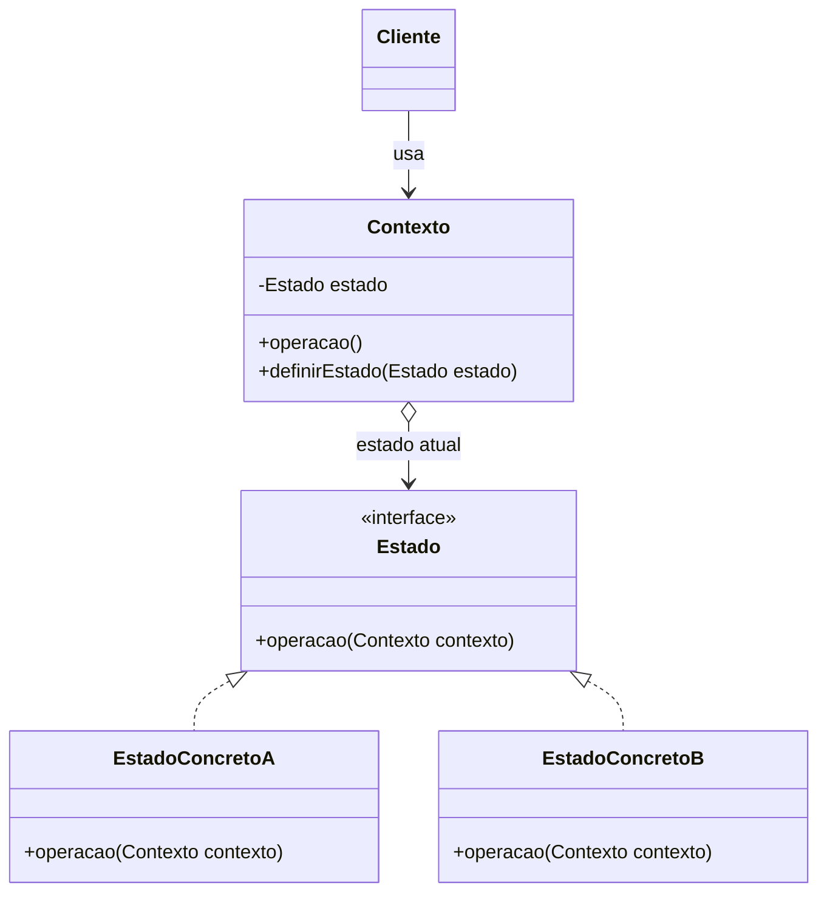

# State (Estado)

## Ideia em uma frase

O **State** permite que um objeto altere seu comportamento quando seu estado
interno muda.

É como perguntar ao objeto:

> "Qual comportamento você deve executar neste estado?"

Em vez de concentrar todas as regras em vários `if` e `else`, o objeto
delegará a operação para uma classe que representa seu estado atual.

## Exemplo simples

Imagine uma conta bancária que pode estar ativa ou bloqueada:

1. Uma conta ativa permite depósitos e saques.
2. Uma conta bloqueada impede depósitos e saques.
3. Uma conta ativa pode ser bloqueada.
4. Uma conta bloqueada pode ser desbloqueada.

O cliente não precisa verificar o estado antes de cada operação. Ele apenas
chama o método da conta:

```java
conta.sacar(50.00);
```

A `ContaBancaria` encaminha a operação para o estado atual. A classe `Ativa`
ou `Bloqueada` decide o que fazer.

## Estrutura padrão



## Papel de cada parte

### Cliente

Usa o contexto e chama suas operações. Ele não precisa conhecer todas as
classes de estado nem implementar as regras de transição.

### Contexto

Mantém uma referência para o estado atual e delega as operações para ele.
Também oferece uma forma de trocar de estado:

```java
public void operar() {
    estado.operar(this);
}

public void definirEstado(Estado estado) {
    this.estado = estado;
}
```

O `this` passado para o estado representa o próprio contexto. Assim, o estado
concreto pode alterar os dados do contexto ou solicitar uma transição.

### Estado

Define o contrato comum para todos os estados. As operações recebem o
contexto quando precisam alterar seu estado:

```java
public interface Estado {
    void operar(Contexto contexto);
}
```

### Estado concreto

Implementa o comportamento específico de um estado e pode definir a próxima
transição:

```java
public void operar(Contexto contexto) {
    contexto.definirEstado(new OutroEstado());
}
```

Cada classe conhece suas próprias regras. Ela não precisa concentrar o
comportamento dos outros estados.

## O que o padrão resolve?

Ele resolve principalmente estes problemas:

- evita muitos `if` e `else` baseados no estado atual;
- separa o comportamento de cada estado em uma classe própria;
- reduz a complexidade do contexto;
- deixa as transições entre estados mais explícitas;
- facilita adicionar novos estados;
- permite que cada estado tenha regras diferentes para a mesma operação.

Sem o padrão, o contexto poderia fazer algo parecido com:

```java
if (estado.equals("ATIVA")) {
    // permite a operação
} else if (estado.equals("BLOQUEADA")) {
    // recusa a operação
}
```

Com o padrão, cada estado implementa sua própria regra:

```java
estado.sacar(this, valor);
```

## Quando usar?

Use quando:

- o comportamento de um objeto depende do seu estado atual;
- existem muitos condicionais relacionados ao estado;
- as transições entre estados são importantes;
- diferentes estados respondem de formas diferentes às mesmas operações;
- você quer adicionar novos estados sem alterar muito o contexto;
- as regras de cada estado podem ser isoladas em classes próprias.

Exemplos comuns:

- pedidos: pendente, pago e enviado;
- contas bancárias: ativa e bloqueada;
- semáforos: vermelho, verde e amarelo;
- personagens: parado, correndo e pulando;
- documentos: rascunho, revisado e publicado;
- conexões: desconectada, conectando e conectada;
- máquinas de venda: sem moeda, com moeda e produto selecionado;
- fluxos de aprovação;
- jogadores e fases de um jogo.

## Quando não usar?

Evite quando:

- o objeto possui apenas um ou dois comportamentos simples;
- o estado não altera o comportamento das operações;
- existem poucas regras e um condicional é mais claro;
- a quantidade de classes tornaria o código mais difícil de entender;
- as transições não possuem regras próprias.

Nesses casos, um `enum`, uma estratégia simples ou uma condição direta pode
ser mais adequado.

## Dicas importantes

1. **Mantenha o estado atual no contexto.**
   O cliente deve conversar com o contexto, e não manipular diretamente a
   classe de estado:

   ```java
   conta.sacar(50.00);
   ```

2. **Deixe cada estado cuidar de seu próprio comportamento.**
   Evite colocar no contexto regras que pertencem a um estado concreto.

3. **Passe o contexto quando o estado precisar fazer uma transição.**
   O `this` permite que o estado altere o objeto que está sendo usado:

   ```java
   estado.avancar(this);
   ```

4. **Defina claramente as transições.**
   Documente quais estados podem ser alcançados a partir de cada estado.

5. **Proteja os dados do contexto.**
   O estado deve usar métodos do contexto, como `definirEstado`, em vez de
   acessar diretamente seus atributos privados.

6. **Teste operações permitidas e recusadas.**
   Um estado pode permitir uma operação e outro pode rejeitá-la.

## Pegadinhas comuns

### 1. Colocar toda a lógica no contexto

Se o contexto continua cheio de `if` e `else`, o padrão não está sendo usado
para separar os comportamentos:

```java
if (estadoAtual == ATIVA) {
    // muitas regras
} else if (estadoAtual == BLOQUEADA) {
    // muitas outras regras
}
```

As regras devem ficar nas classes concretas correspondentes.

### 2. Esquecer de atualizar o estado

Se uma operação deveria mudar o estado, mas não chama `definirEstado`, o
contexto continuará executando o comportamento anterior.

### 3. Permitir transições inválidas

Cada estado deve decidir quais transições são permitidas. Uma conta
bloqueada, por exemplo, não deve ser desbloqueada por uma operação destinada
a alterar o saldo.

### 4. Criar estados sem comportamento diferente

Se duas classes de estado fazem exatamente a mesma coisa, talvez elas não
precisem ser estados separados.

### 5. Confundir estado com estratégia

Na **Strategy**, o cliente normalmente escolhe o algoritmo que será usado.
No **State**, o contexto possui um estado atual e as operações podem provocar
transições para outros estados.

### 6. Criar transições difíceis de acompanhar

Quando muitos estados podem apontar para muitos outros, o fluxo fica difícil
de entender. Use diagramas e mantenha as transições bem documentadas.

## State x Strategy

Os dois padrões encapsulam comportamentos em classes que implementam uma
abstração, mas têm objetivos diferentes:

| State | Strategy |
|---|---|
| Representa o estado atual de um objeto. | Representa um algoritmo escolhido. |
| As operações podem mudar o estado. | A estratégia geralmente é escolhida pelo cliente. |
| A transição faz parte do fluxo do objeto. | A troca costuma ser uma configuração. |
| Exemplo: conta ativa ou bloqueada. | Exemplo: rota de carro ou transporte público. |

## Resumo

```text
Cliente
   |
   v
Contexto --> Estado atual
                |
                v
       EstadoConcretoA
                |
        muda para outro estado
                |
                v
       EstadoConcretoB
```

O State transforma o comportamento dependente de estado em objetos
separados. O contexto delega a operação para o estado atual, e o estado
concreto decide como agir e, quando necessário, qual será o próximo estado.