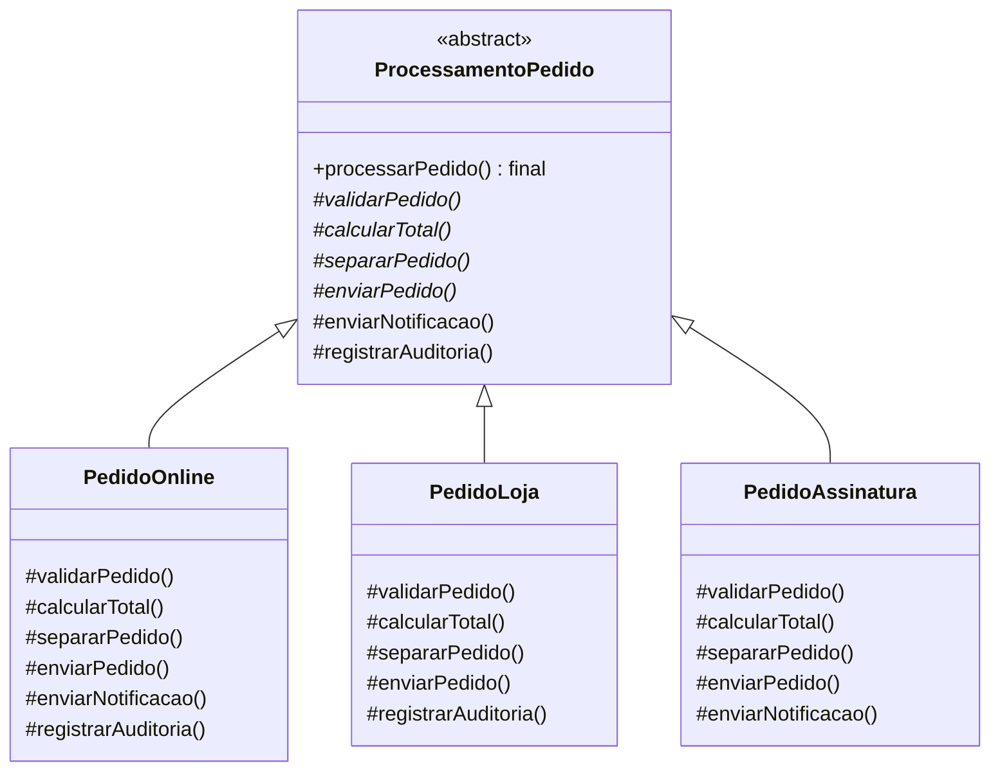

# Diagrama UML

`processarPedido` controla o fluxo comum. Os quatro primeiros metodos sao
etapas obrigatorias; `enviarNotificacao` e `registrarAuditoria` sao hooks com
implementacao vazia, usados apenas pelas subclasses que precisam deles.
