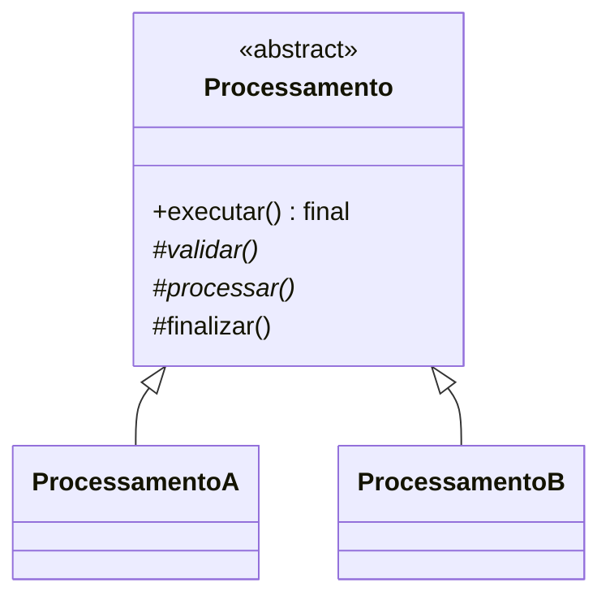
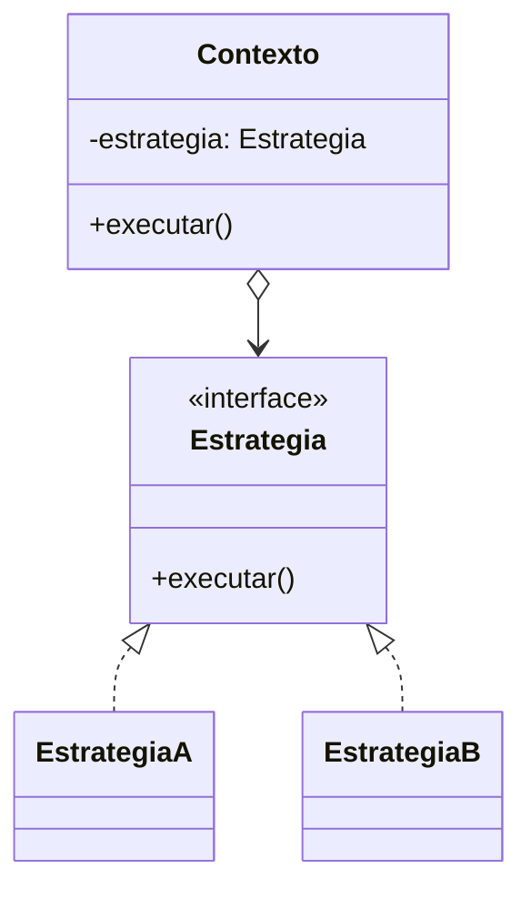

# Template Method x Strategy

Os dois padroes permitem variar partes de um comportamento, mas fazem isso
com estruturas diferentes:

- **Template Method** usa heranca para fixar o esqueleto de um algoritmo.
- **Strategy** usa composicao para trocar um algoritmo completo por outro.

## Diferenca principal

### Template Method

A classe abstrata define a ordem das etapas. As subclasses implementam ou
sobrescrevem apenas os passos que variam.

```java
abstract class Processamento {
    public final void executar() {
        validar();
        processar();
        finalizar();
    }

    protected abstract void processar();
    protected void finalizar() {}
}
```

O fluxo `executar()` e controlado pela classe base. A subclasse nao deve
alterar a ordem do algoritmo.

### Strategy

Uma classe delega uma operacao para um objeto que representa uma estrategia.
Essa estrategia pode ser trocada sem criar uma subclasse da classe principal.

```java
interface Estrategia {
    void executar();
}

class Contexto {
    private Estrategia estrategia;

    public void executar() {
        estrategia.executar();
    }
}
```

O contexto define quando usar a estrategia, mas a estrategia define o
algoritmo que sera executado.

## Quando usar cada um

| Situacao | Padrao indicado |
|---|---|
| Todas as variacoes seguem as mesmas etapas e na mesma ordem | Template Method |
| Apenas uma ou algumas etapas precisam ser personalizadas | Template Method |
| O algoritmo completo pode ser substituido | Strategy |
| O comportamento precisa mudar em tempo de execucao | Strategy |
| Quer evitar criar subclasses para cada variacao | Strategy |
| As variacoes dependem de uma estrutura comum da classe base | Template Method |
| Ha necessidade de reutilizar a mesma estrategia em varios contextos | Strategy |

## Exemplo comparativo

### Template Method: processamento de pagamento

Todos os pagamentos seguem o fluxo:

1. Validar dados.
2. Autorizar pagamento.
3. Realizar pagamento.
4. Emitir comprovante.

Cartao e Pix implementam as etapas especificas, mas a ordem permanece fixa.
Esse e o caso dos exercicios deste modulo, como
[Pagamento](./exercicios/04/Pagamento.java).

### Strategy: calculo de frete

Um pedido pode receber uma estrategia de frete:

- `FreteCorreios`
- `FreteJadlog`
- `FreteTransportadora`

O pedido usa uma delas para calcular o frete. A estrategia pode ser trocada
sem alterar o pedido e sem obrigar todas as estrategias a seguir varias etapas
em uma ordem fixa.

## Como perceber em diagramas UML

### Sinais de Template Method

Procure:

- Uma classe abstrata no topo.
- Uma operacao publica, geralmente `final`, que coordena varias etapas.
- Metodos abstratos ou protegidos na classe base.
- Subclasses ligadas por heranca (`<|--`).
- Hooks com implementacao vazia ou comportamento padrao.



Pergunta para confirmar: **a classe pai controla a ordem e as filhas
preenchem os passos?** Se sim, provavelmente e Template Method.

### Sinais de Strategy

Procure:

- Uma interface ou classe abstrata que representa um algoritmo.
- Varias implementacoes da estrategia.
- Uma classe de contexto que possui uma estrategia como atributo.
- Uma relacao de associacao ou composicao entre contexto e estrategia.
- Normalmente, nao ha heranca entre o contexto e as estrategias.



Pergunta para confirmar: **o contexto possui uma estrategia e delega para ela,
podendo trocar essa estrategia?** Se sim, provavelmente e Strategy.

## Diferenca visual rapida

```text
Template Method

ClasseBase
    ^
    | heranca
    +-- ImplementacaoA
    +-- ImplementacaoB

ClasseBase.executar()
    -> etapa 1
    -> etapa variavel
    -> etapa 3
```

```text
Strategy

Contexto ---- possui ----> Estrategia
                              ^
                              | implementacao
                              +-- EstrategiaA
                              +-- EstrategiaB

Contexto.executar()
    -> estrategia.executar()
```

## Cuidado com a confusao

Uma classe abstrata com subclasses nao significa automaticamente que o padrao
e Template Method. E necessario existir um metodo da classe base que controle
um algoritmo formado por varias etapas.

Da mesma forma, uma interface com varias implementacoes nao e suficiente para
identificar Strategy. Deve existir um contexto que receba, mantenha ou use
essa interface para delegar o comportamento.

### Regra pratica

- **Heranca + algoritmo fixo com etapas variaveis = Template Method.**
- **Composicao + algoritmo substituivel = Strategy.**

Se a variacao precisa mudar durante a execucao, prefira Strategy. Se a ordem
das etapas e uma regra do processo e deve ser protegida, Template Method tende
a ser mais adequado.
