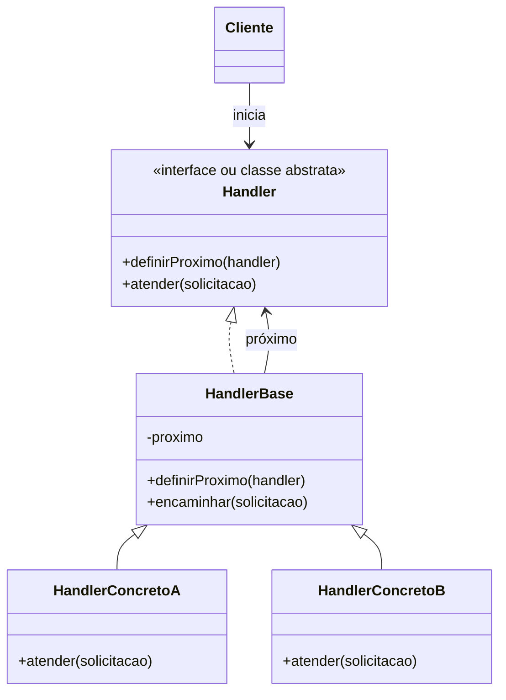

# Chain of Responsibility (Cadeia de Responsabilidade)

## Ideia em uma frase

O **Chain of Responsibility** passa uma solicitação por uma sequência de objetos até que algum deles consiga atendê-la.

É como perguntar:

> "Você consegue resolver este problema?"

Se a resposta for "não", o objeto encaminha o problema para o próximo da cadeia.

## Exemplo simples

Imagine uma central de suporte:

1. O suporte de nível 1 tenta resolver.
2. Se não conseguir, passa para o suporte de nível 2.
3. Se ainda não conseguir, passa para o gerente.
4. Se ninguém conseguir, a solicitação não é atendida.

O cliente não precisa saber quem resolverá o problema. Ele apenas inicia a cadeia pelo primeiro suporte.

```java
nivel1.atender(3);
```

O nível 1 verifica o problema. Como não atende o nível 3, chama `encaminhar(3)`. Esse método chama o próximo objeto, que é o nível 2. O processo continua até alguém resolver ou até a cadeia acabar.

## Estrutura padrão



## Papel de cada parte

### Cliente

Inicia a solicitação chamando o primeiro objeto da cadeia. Ele não precisa conhecer todos os responsáveis.

### Handler

Define o contrato comum. Normalmente possui:

- um método para atender a solicitação;
- um método para definir o próximo objeto.

### HandlerBase

É uma classe opcional que guarda o próximo handler e possui a lógica de encaminhamento.

No exemplo deste diretório, ela corresponde à classe abstrata `Suporte`:

```java
protected Suporte proximo;

protected void encaminhar(int nivel) {
    if (proximo != null) {
        proximo.atender(nivel);
    }
}
```

### Handler concreto

Tenta resolver a solicitação. Se conseguir, termina o processo. Se não conseguir, chama o próximo:

```java
public void atender(int nivel) {
    if (nivel == 1) {
        System.out.println("Resolvido");
    } else {
        encaminhar(nivel);
    }
}
```

## O que o padrão resolve?

Ele resolve principalmente estes problemas:

- evita um método enorme com muitos `if` e `else`;
- evita que o cliente conheça todos os possíveis responsáveis;
- reduz o acoplamento entre quem envia e quem processa a solicitação;
- permite adicionar, remover ou reordenar responsáveis;
- permite que cada classe tenha uma responsabilidade pequena e clara.

Sem o padrão, o cliente poderia precisar fazer algo parecido com:

```java
if (nivel == 1) {
    // suporte 1
} else if (nivel == 2) {
    // suporte 2
} else if (nivel == 3) {
    // gerente
}
```

Com o padrão, cada classe conhece apenas sua própria regra e o próximo elemento.

## Quando usar?

Use quando:

- existem vários objetos que podem tratar a mesma solicitação;
- apenas um responsável, ou nenhum, deve atender;
- a ordem dos responsáveis é importante;
- você quer evitar muitos condicionais no cliente;
- a cadeia pode mudar durante a execução;
- o cliente não deve conhecer a lógica de escolha do responsável.

Exemplos comuns:

- níveis de suporte técnico;
- aprovação de despesas;
- filtros de requisições web;
- validações em sequência;
- tratamento de eventos;
- middleware;
- regras de autorização;
- processamento de descontos ou impostos.

## Quando não usar?

Evite quando:

- sempre existe um único responsável;
- a solicitação obrigatoriamente precisa passar por todos os objetos;
- a ordem da cadeia não importa;
- é essencial garantir que alguém sempre processe a solicitação;
- a cadeia ficaria tão grande que seria difícil descobrir quem tratou o pedido.

Nesses casos, uma chamada direta, uma estratégia ou outro padrão pode ser mais simples.

## Dicas importantes

1. **Comece pelo primeiro objeto.**
   O cliente normalmente chama apenas o início da cadeia:

   ```java
   nivel1.atender(nivel);
   ```

2. **Use uma abstração comum.**
   Todos os handlers devem possuir o mesmo método, como `atender`.

3. **Deixe cada classe cuidar de uma regra.**
   O suporte de nível 1 não deve conhecer os detalhes do gerente.

4. **Defina claramente o fim da cadeia.**
   Pode ser uma mensagem, um valor padrão, uma exceção ou uma ação específica.

5. **Teste a ordem.**
   Trocar os handlers de posição pode mudar o resultado.

6. **Documente quem pode tratar cada solicitação.**
   Isso facilita a manutenção da cadeia.

## Pegadinhas comuns

### 1. Esquecer de encaminhar

Se o handler não conseguir resolver e também não chamar o próximo, a cadeia para naquele ponto:

```java
if (naoConsigoResolver) {
    // faltou chamar o próximo
}
```

### 2. Criar uma referência para o próximo errado

Se `nivel1` apontar para ele mesmo, haverá chamadas infinitas e provavelmente um `StackOverflowError`.

### 3. Não tratar o fim da cadeia

Quando não existe próximo handler, é preciso decidir o que fazer. No exemplo:

```java
if (proximo != null) {
    proximo.atender(nivel);
} else {
    System.out.println("Nenhum suporte disponível");
}
```

### 4. Mais de um objeto tratar sem intenção

O padrão geralmente é usado para que o primeiro handler adequado resolva a solicitação. Se a solicitação deve passar por todos, talvez outro padrão seja mais apropriado.

### 5. Cadeia difícil de visualizar

Uma cadeia montada em vários lugares fica difícil de entender. Monte-a em um ponto claro da aplicação, como uma fábrica ou configuração.

### 6. A solicitação não ser tratada por ninguém

O padrão não garante que haverá um responsável. Sempre pense no comportamento para solicitações desconhecidas.

## Resumo

```text
Cliente
   |
   v
Handler 1 --não resolve--> Handler 2 --não resolve--> Handler 3
   |                          |                         |
 resolve                  resolve                   resolve
```

O Chain of Responsibility é uma sequência de tentativas. Cada objeto decide entre:

- **resolver** a solicitação; ou
- **encaminhar** para o próximo.

Essa é a principal ideia do padrão.